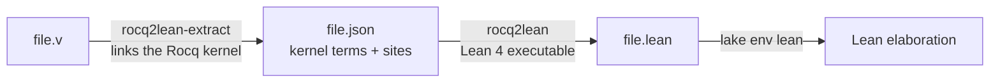

# rocq2lean

Carry the automatically translatable fragment of Rocq (formerly Coq) into Lean 4.

The translation has **no correctness guarantee**. It moves kernel terms
structurally and marks everything it will not carry. A translated theorem is a
Lean theorem of a translated statement, proved by a translated Rocq proof
*t erm*; whether the two statements mean the same thing depends on the small,
explicit mapping table described below, not on a proof.

## Pipeline



* **Extractor** (`extractor/`, OCaml): opens a real Rocq session, interprets the
  file sentence by sentence, and after the file is finished reads every
  declaration back out of the *final* global environment. Reading at the end is
  what makes sections work: a constant declared inside a section is read in its
  discharged form, with the section hypotheses already products of its type.
* **Translator** (`Rocq2Lean/`, Lean 4): parses that JSON, resolves names, and
  emits Lean source. It is a normal Lean executable, so the second half of the
  pipeline needs no other language.

Proofs cross as **kernel proof terms**, not as tactics. `induction`, `rewrite`
and the rest run inside Rocq; what crosses the boundary is the term Rocq's
kernel checked. There is no tactic translation, and therefore no guessing at
what a proof script meant.

### From proof terms to scripts

A second, syntax-directed pass turns a proof term into a tactic script when it
recognises the shape, and leaves the term otherwise:

| Term shape | Script |
|---|---|
| leading `fun` binders | `intro x y` |
| `Eq.refl` | `rfl` |
| an induction principle (`_ind`, `_rect`, `_rec`) applied to motive, branches and a scrutinee | `induction x with \| ctor … => …` |
| `eq_ind`/`eq_ind_r` (and `eq_rect`, `eq_rec`) | `rw [e]; …`, with the term as fallback |
| a single-constructor `Case` on a hypothesis | `rcases h with ⟨a, b⟩; …` |
| `(fun x y => body) a b` with variables `a`, `b` | `body` in the extended scope |
| anything else | `exact <term>` |

The fallback is always the term, so an unrecognised shape still compiles. Two
kernel details matter and are handled:

* Rocq's branch telescope **interleaves** constructor arguments and induction
  hypotheses (`l IHl r IHr`); Lean's `induction` pattern takes the arguments
  first (`l r IHl IHr`).
* Lean names `induction` alternatives by the constructor's **short** name
  (`zero`, not `Nat.zero`).

Covered: the mapped `nat`, `bool`, `list`, `option` eliminators and `and`/`or`/
`ex`, plus a file's own `_ind`/`_rect`/`_rec` for a single, non-indexed,
non-mutual inductive. Nested induction works when the inner eliminator is fully
applied to its own arguments; an eliminator whose result is then applied to a
hypothesis falls back to the term. Multi-branch `Case` terms keep their `match`
because focusing several generated goals in one inline script needs bullets;
indexed induction is still skipped. Reduction is bounded (`fuel`) so a chain of
rewrites cannot multiply the output without limit.

Every script is emitted as `first | <script> | exact <term>`: a shape the
reducer gets wrong degrades to the term instead of breaking the file.
`--strict-scripts` omits that net, and `tests/run.sh` translates every case both
ways — so on this suite the scripts are known to elaborate on their own, while a
user's file keeps the fallback.

## Quick start

```console
$ nix develop
$ tests/run.sh
```

`tests/run.sh` re-enters the dev shell itself, so it also works from outside:

```console
$ ./tests/run.sh
```

One file by hand:

```console
$ nix develop -c bash -c '
    extractor/_build/default/bin/main.exe -- path/File.v build/File.json
    lake exe rocq2lean build/File.json build/File.lean
    lake env lean build/File.lean'
```

Rocq flags go before `--` (so `-Q`, `-R`, `-include` keep working); the input
and output paths go after it. The extractor reads the standard library from
`ROCQPATH`, which the dev shell sets. Rocq 9 names the library `Stdlib`, so
sources should say `From Stdlib Require Import Lists.List.` (`From Coq …` still
resolves through the compatibility alias.)

A file's constants are named by its **library name**, derived from the output
path and the `-R`/`-Q` flags exactly as `rocq compile` does it. That is what
makes `compcert.lib.Maps.PTree.get` mean the same constant in every file. A file
whose name is not a valid Rocq identifier falls back to the interactive
document, whose constants are `Top.*`.

Several files can be translated into one Lean file, in dependency order:

```console
$ rocq2lean --join build/All.lean build/Coqlib.json build/Maps.json
```

`--join` is what makes cross-file references resolve: the translator registers
every declaration in the joined unit, and the stable topological sort orders
them. With a large library, three options narrow the unit:

```console
$ rocq2lean --join out.lean --root compcert.lib. \
    --statements-only --axiomatise-theorems \
    stdlib.json compcert.json
```

* `--root <prefix>` keeps only declarations reachable from names with that
  prefix. `--root compcert.lib.` selects Coqlib/Maps and the stdlib declarations
  they actually use, instead of every lemma of every loaded module.
* `--statements-only` keeps every definition body and replaces only theorem
  proofs with a marked `sorry`.
* `--axiomatise-theorems` emits proof-valued declarations as `axiom`s under the
  marker `ROCQ2LEAN-ASSUMED`, so the trusted base is an enumerable list rather
  than `sorryAx`.
* `--axiomatise-prefix <prefix>` assumes declarations even when they are
  definitions, for stdlib modules whose computation the target does not need.

The extractor's `--no-proof-bodies` drops the body of every proof-valued
constant while extracting, which is what keeps a stdlib module's JSON to its
statements.

## The markers

Everything the translation refuses to carry is marked with the token
`ROCQ2LEAN-UNTRANSLATED`, in one of three forms.

| Situation | Generated Lean | Consequence |
|---|---|---|
| Type cannot be translated | block comment with the reason; declaration omitted | Lean reports the name at each use site |
| Body cannot be translated, type can | `def … := by` + `-- ROCQ2LEAN-UNTRANSLATED: reason` + `sorry` | file elaborates; `#print axioms` shows `sorryAx` |
| A reference has no declaration and no mapping | emitted as its flattened name, listed in the file's report | Lean reports the unknown identifier |

The file also ends with an `## Assumptions` section when a declaration was
emitted but depends on Lean inferring something the translation does not write
down (today: the motive of an indexed `match`). That is not a failure marker; it
is the short list to read first when Lean rejects a generated declaration.

The translator also prints a summary and every marker to stderr. Omitted
declarations are loud on purpose: a file that references one fails to
elaborate, rather than compiling against an invented axiom.

## Supported fragment

Terms (kernel constructors):

| Rocq | Lean |
|---|---|
| `Rel`, `Var` | scoped names (rendered uniquely; Rocq shadowing is renamed) |
| `Sort` | `Prop`, `Set`/`Type` → `Type` |
| `Cast` | erased |
| `Prod`, `Lambda`, `LetIn`, `App` | `→`, `fun`, `let`, application |
| `Const`, `Ind`, `Construct` | mapped or flattened names; `@` keeps kernel arity |
| `Case` | `match` (the kernel's return predicate is not emitted; Lean infers it) |
| `Fix` | `let rec` (single function), with the kernel's `Γ, f₁ … fₖ, args` scope; mutual blocks are marked |
| `Proj` | `Record.field` |
| `Int`, `Float`, `Array`, `Meta`, `Evar`, `CoFix` | untranslated marker |
| `SProp`, `QSort` | untranslated marker |

Vernacular:

* `Definition`, `Fixpoint`, `CoFixpoint` (marked), `Inductive`, `Record`,
  `Theorem`/`Lemma`/`Corollary`/`Example`, `Axiom`/`Parameter`/`Conjecture`.
* Sections are interpreted and their constants read back discharged.
* `Require`/`Import` are executed so the file can be checked; the imported
  declarations are not emitted. References to them resolve only through the
  mapping table, otherwise they are reported as unresolved.
* Notations, `Ltac`, options, hints and the rest of the proof-engine harness are
  interpreted but produce no Lean output. Terms are already elaborated, so
  notations are not needed to express them.
* There is no translation of modules, functors, type classes, or `Instance`
  declarations beyond the constants they generate.
* Files are translated one at a time; a `Require` of another translated file is
  an unresolved reference, not an `import` of the generated Lean.

## The trusted mapping

`Rocq2Lean/Names.lean` holds three tables (`mappedTypes`, `mappedCtors`,
`mappedConstants`) and `Rocq2Lean/Prelude.lean` holds the Lean side of every
constant in them. An entry asserts that the Rocq global and the Lean global are
the same theory for translation purposes. That is an assumption, not a theorem.

Two rules keep the assumption usable:

1. The Lean side keeps Rocq's **argument order and explicitness**. Kernel
   applications are passed through, so a binder Lean would hide has to be
   written.
2. Definitions are mapped only to a Lean definition with the same *recursion
   scheme*. `Nat.add` recurses on its second argument in Lean and on its first in
   Rocq, so `Corelib.Init.Nat.add` maps to `Rocq2Lean.add`, a Rocq-shaped
   definition; mapping it to `Nat.add` would carry proof terms across a
   definition they do not match.
3. A Rocq global whose name is in a table is **not emitted**, even when the
   file being joined declares it. The mapping decides which side of the
   boundary the name denotes; emitting the stdlib definition as well would put
   two incompatible constants under one generated name. This is what keeps
   `Stdlib.Arith.PeanoNat.Nat.min` and the prelude's `Nat.min` the same
   constant when both appear in a closure.

Mapped today: the `Init` logic (`eq`, `and`, `or`, `ex`, `True`, `False`, their
eliminators, `f_equal`), `nat`, `bool`, `unit`, `prod`, `sum`, `list`, `option`,
and `add`/`mul`. `iff` is mapped to `Rocq2Lean.iff`, a Rocq-shaped definition
(`(A → B) ∧ (B → A)`), not to Lean's `Iff` structure: Coq proof terms build an
`iff` with `conj` and project it with `proj1`/`proj2`. Extend the table and the
prelude together, then add a test that elaborates the result.

## Assumptions and limits

* **Universes are erased.** Lean re-infers them from the carried term. This is
  usually invisible and occasionally wrong in a way Lean cannot see.
* **`Set` is `Type`.** The predicativity difference is not modelled.
* **A `match`'s motive is dropped.** Lean infers it. When the expected type does
  not mention the index — a proof built by `inversion` is the common case — Lean
  cannot infer the motive, rejects the generated `match`, and the declaration is
  listed under `## Assumptions`. It is not marked automatically, because the
  translation is syntax-directed and does not typecheck its output.
* **Mutually recursive fixed points are marked**, not emitted. Lean's
  `let rec … and …` is layout-sensitive inside an expression, and emitting
  syntax that parses only at the top level would be worse than a marker.
* **Opaque proofs are read with the kernel's opaque accessor.** The term is
  there; the deprecation warning is acknowledged in `extractor/lib/readback.ml`.
* **Rocq's derived `_sind` eliminator** (SProp elimination) is generated for
  every inductive and is always marked: Lean has no SProp. Expect one marker per
  inductive, and expect nothing to depend on it.
* **No imports between generated files.** `--join` turns a dependency-ordered
  set of files into one Lean file; there is no per-module `import` emission yet.
* Toolchain: Rocq 9.1.1 with the `Stdlib` library, Lean 4.35.0, OCaml 4.14
  (the compiler Rocq was built with).

## Repository layout

```
extractor/          OCaml extractor; links rocq-runtime
Rocq2Lean/
  IR.lean           typed view of the JSON intermediate; strict parsing
  Names.lean        flattening and the trusted mapping tables
  Translate.lean    kernel term → Lean term
  Emit.lean         declarations, ordering, markers, report
  Prelude.lean      Rocq-shaped Lean definitions for the mapping
  Main.lean         CLI
tests/cases/*.v     end-to-end cases
tests/run.sh        extract, translate, elaborate, check markers and axioms
```

## Testing

`tests/run.sh` is the contract:

* every case is extracted, translated, and elaborated by Lean;
* every generated `theorem` is checked with `#print axioms` — a translated proof
  must not depend on `sorryAx` or on any axiom;
* cases that must be partially untranslated are asserted to carry a marker, and
  fully translatable cases are asserted to carry none.

## What carries: the mini project

`examples/mini` is four ordinary files: an expression syntax and evaluator, a
substitution function with a theorem about it, bounded arithmetic with a
module, and an indexed vector. `tests/mini.sh` reproduces the numbers below
(it reads the stdlib JSONs from `tests/compcert-a1.sh`, so run that once first).

**Definitions and statements carry.** 37 declarations join with the stdlib
compatibility JSONs, 0 unresolved references, 0 Lean errors; the 12 theorem
statements are assumed. Inductives, records, modules, functors, `Fixpoint`s,
`if`/`match` definitions, and theorem statements all elaborate.

**Proof terms are translated, and some do not typecheck.** The same files with
Rocq's proof terms produce 60 declarations (the mini project plus the stdlib
declarations in its closure), 29 unresolved references, 8 markers (five stdlib
lemmas whose bodies were dropped and three SProp `_sind` eliminators), and 10
Lean errors in five declarations. Four of the nine mini theorems elaborate:

| Theorem | Result | Cause when it fails |
|---|---|---|
| `Syntax.sample_eval` | ok | |
| `Vec.vto_list_length` | ok | |
| `Bounded.Clamp3.clamp_le` | ok | |
| `Bounded.Clamp3.clamp_idem` | ok | |
| `Syntax.eval_optimize` | error | dependent `destruct … eqn:`: the `Case` motive mentions the equation |
| `Subst.teval_tsubst` | error | dependent `destruct … eqn:` over `Nat.eqb`; the branch's equation is not transported into the goal |
| `Vec.vcons_inj` | error | `inversion` on an indexed inductive: the motive mentions the index |
| `Bounded.add_bound` | error | `lia`: proof term pulls `micromega`/`Zify`/`Znat`, unresolved |
| `Bounded.size_bound` | error | `lia`, as above |

The failures are loud: every one is a Lean error at a named declaration, no
`sorry` is emitted for them, and the generated file marks the stdlib bodies it
had to assume. They are not a proof-script problem — the scripts ran in Rocq;
what does not carry is the *term* shape those scripts produced (dependent
elimination that carries an equation or an index, and `lia`'s decision
procedure). Those are the two boundaries to work on next; ordinary definitions
and induction proofs already cross. Three of the five failures are the
dependent-`Case` gap; two are `lia`.

## Toward CompCert

The intended target is CompCert. It is not translated yet, but two measurable
milestones are reached: **Coqlib + Maps** and **`common/AST.v`** elaborate.

| | A1 | A2 |
|---|---|---|
| Target | `lib/Coqlib.v` + `lib/Maps.v` | `common/AST.v` |
| Declarations in the closure | 476 | 244 |
| Unresolved references | 0 | 0 |
| Lean errors | 0 | 0 |
| Assumed declarations | 269 | 37 |
| Untranslated markers | 7 | 11 |

`tests/compcert-a1.sh` reproduces A1 end to end (extract, join, elaborate) in
about 75 seconds: `A1: 476 declarations, 269 assumed, 0 unresolved, 0 Lean
errors`. `tests/compcert-a2.sh` reproduces A2 in about eight minutes: it builds
CompCert with its own Makefile (which needs `coqdep`; the dev shell appends the
caller's PATH for it), extracts the closure, and prints `A2: 244 declarations,
37 assumed, 0 unresolved, 0 Lean errors`. Three Flocq `Prop/*` modules are
skipped: they are proof-only, are not in AST's closure, and trip an internal
Rocq assertion when processed as a library.

A2's closure is the AST file plus the declarations it actually mentions from
`Errors`, `Integers`, `Floats`, Flocq, `Archi`, `String`, and `SpecFloat`; the
whole `Reals`/proof side of Flocq is not pulled. The 37 assumptions are the AST
theorems (proofs are A3), four more decision procedures, and the same class of
`ZArith_dec`/`sumbool` functions as A1.

The assumptions named so far: all CompCert theorems; `ZArith_dec`'s
`Z_lt_dec`/`Z_le_dec`/`Z_le_gt_dec`; `Int.eq_dec`, `Int64.eq_dec`,
`Ptrofs.eq_dec`, `bool_dec`, `calling_convention_eq`, `signature_eq`,
`Beq_dec`; and the six dependent-match definitions in Coqlib/Maps. Each is a
`ROCQ2LEAN-ASSUMED` declaration with its translated statement, so the trusted
base is enumerable with `#print axioms`.

What is translated exactly in that unit: the numeric tower (`positive`, `N`,
`Z`, `Pos.add`/`mul`, `Z.add`/`mul`/`compare`/`div`…), lists, `sumbool`,
`comparison`, the class hierarchy, and the definitions of `Coqlib`/`Maps`
including `PTree`, `ZMap`, and the `PTree` functor instantiations. `Pos.add` and
`Pos.add_carry` are emitted as a Lean `mutual` block; mutually recursive
fixpoints no longer need to be marked.

The assumed dependent-match definitions (`option_eq`, `list_norepet_dec`,
`tree_ind'`, `Equal_dec`, `fold_ind`, `fold_ind_aux`, and the decision
procedures above) need an explicit `Case` motive; a later step will carry them,
or write them by hand, rather than leave them axiomatic.

The remaining path:

* **A3 — proofs** in `lib/` and `common/`, starting with `Coqlib` and `Maps`.
  Each assumed CompCert theorem's `axiom` is replaced by its translated proof;
  the name and statement do not change. This also removes the need for the
  decision-procedure assumptions where a proof only uses them.
* **A4 — definitions beyond AST**: `Values`, `Memory`, the backend and
  frontend, still statements-only.
* **A5 — semantic layers and the correctness theorem.**

Known hard points beyond the numeric tower: coinduction (7 files), `Program`
obligations (27), `Derive`, and proof terms from `lia`/`ring` whose lemma
statements pull the micromega hierarchy. Each is either translated or becomes a
named assumption.

## License

Apache-2.0. Copyright 2026 CR Scidonia Limited. See `LICENSE` and `NOTICE`.
